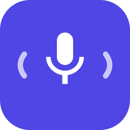

<p align="center"></p>

<h1 align="center">VoiceKey</h1>

<p align="center"><b>Голос с кнопки микрофона на проекторе Hisense / Vidda.</b><br>Сказали — открылось. Без облака приложений и без Google TV.</p>

VoiceKey — приложение для Android TV-прошивок Hisense (проверено на Vidda C2 Ultra, VIDAA на Android 11). Оно забирает кнопку микрофона на пульте и делает с ней то, чего не умеет штатный ассистент.

- **Голосовые команды.** Нажали кнопку и сказали: «открой Лампу», «найди на ютубе трейлер Дюны», «найди в кинопоиске Интерстеллар» или просто название. Работает с TizenTube, Lampa, Кинопоиском, VK Видео, Rutube.
- **Поиск внутри открытого приложения.** Удержание кнопки — поиск там, где вы сейчас.
- **Два распознавателя.** Онлайн (Google) или офлайн (Vosk, русская модель ~46 МБ, скачивается один раз).
- **«Продолжить просмотр».** Недосмотренные в TizenTube и Lampa видео попадают в ряд лаунчера.
- **Экранный переводчик.** Китайские и английские надписи в системных настройках прошивки показываются по-русски поверх экрана (словари — отдельно, см. [docs/translator.md](docs/translator.md)).
- **Возвращается после сна.** Прошивка при засыпании убивает почти все приложения вместе со службой доступности; VoiceKey сам включает её обратно.
- **Настройки на экране.** Что делает нажатие и удержание, время удержания, движок распознавания, звуки, переводчик.

## Установка

Нужен компьютер с [adb](https://developer.android.com/tools/adb) в одной сети с проектором. На проекторе включите «Отладка по USB / по сети» в режиме разработчика.

1. Скачайте `VoiceKey.apk` со страницы [Releases](../../releases/latest) (или соберите сами, см. ниже).
2. Подключитесь и установите:

   ```sh
   adb connect <адрес-проектора>:5555
   adb install -r VoiceKey.apk
   ```
3. Выдайте права, которые приложение само себе выдать не может:

   ```sh
   adb shell pm grant dev.xdark.voicekey android.permission.WRITE_SECURE_SETTINGS
   adb shell pm grant dev.xdark.voicekey android.permission.RECORD_AUDIO
   adb shell cmd notification allow_listener dev.xdark.voicekey/dev.xdark.voicekey.WakeListener
   ```
4. Запустите VoiceKey из лаунчера. Он включит свою службу доступности (если нет — «Настройки → Специальные возможности → VoiceKey: кнопка микрофона»).
5. Для онлайн-распознавания нужен установленный `org.vidda.googlevoicesearch` (его VoiceKey только использует, не поставляет). Без него включите офлайн-движок в настройках приложения.

Проверка: `adb shell am start -n dev.xdark.voicekey/.TestPhrase --es phrase 'открой лампу'` — выполнит фразу так, будто её сказали.

## Как пользоваться

- **Нажатие** на кнопку микрофона — сказать команду.
- **Удержание** — голосовой поиск в приложении на экране (или панель Google, если приложение не умеет).
- Что делает каждое из двух и сколько держать — в настройках VoiceKey (сам значок в лаунчере).
- Приложения называйте как угодно: «ютуб», «лампа», «кинопоиск», «вк видео», «рутуб».

## Если что-то не так

- **Журнал работы:** `adb shell dumpsys activity service dev.xdark.voicekey/.KeyService` (и `/.WakeListener`, если служба не работает).
- **Служба не включилась после сна:** запустите значок VoiceKey из лаунчера — он включит её вручную и скажет, как прошло.
- **Любое нажатие на пульте «прожимается» несколько раз после выхода из сна.** Замечено на Vidda C2 Ultra вместе с лаунчером [Lumbina](https://github.com/Kasavy/lumbina) 0.0.6: помогает выключить его «службу пульта» в специальных возможностях. К VoiceKey это не относится (проверено сырыми событиями `getevent`: аппаратно кнопка срабатывает один раз).

## Сборка

Без Gradle: `aapt2 → javac → d8 → zipalign → apksigner`.

Нужны JDK 17+ (путь в `JAVA_HOME`, по умолчанию `~/.local/opt/jdk`), Android SDK с build-tools 35.0.0 и platform android-30 (`ANDROID_HOME`, по умолчанию `~/.local/opt/android-sdk`), `curl`, `zip`.

```sh
tools/fetch-libs.sh   # Vosk и JNA с Maven Central, с проверкой контрольных сумм
./build.sh            # получится VoiceKey.apk
```

Ключ подписи `voicekey.keystore` создаётся при первой сборке рядом с проектом. Храните его: обновления должны быть подписаны тем же ключом. Приложение собирается под arm64.

## Устройство

Исходники в `src/dev/xdark/voicekey`, у каждого класса есть описание в начале файла. Ключевые: `KeyService` (перехват кнопки), `RemoteMic` (звук с микрофона пульта), `Command` (разбор фразы), `VoiceActivity` (распознавание), `WakeListener`/`BootReceiver` (возврат после сна), `Translator` (экранный переводчик), `WatchNext` (продолжить просмотр).

## Лицензия

[GPL-3.0-or-later](LICENSE). Сторонние компоненты — в [NOTICE.md](NOTICE.md).
